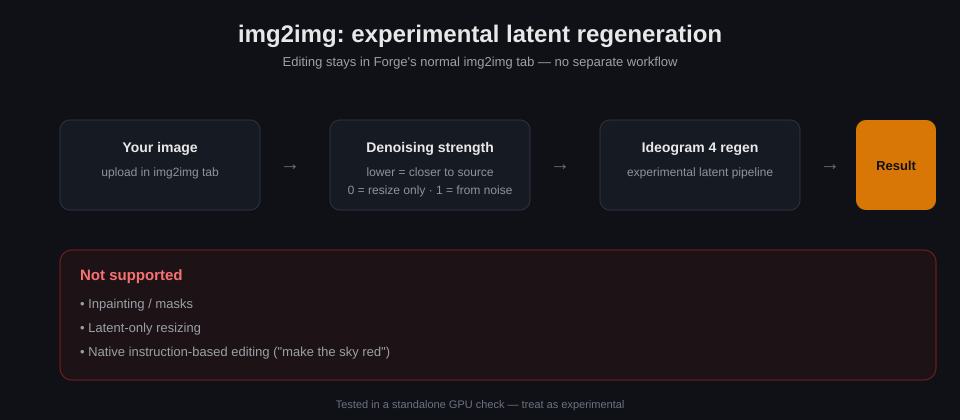

# Project Invisible — Ideogram 4 for Forge Neo

**Ideogram 4 in Forge's familiar workflow. No separate generation tab or extra Python environment.**

[Installation](#beginner-installation) · [Models](#model-files) · [Step-by-step usage](#step-by-step-usage) · [UI tour](#ui-tour) · [Update safety](UPDATE_SAFETY.md) · [Technical notes](docs/TECHNICAL.md)

## The Project Invisible idea

Use Forge's normal checkpoint selector, prompt, Generate button and image folders.
Occasional Ideogram choices live in Forge **Settings**, with optional Quicksettings. The extension adds no accordion.
“Invisible” means familiar—not hiding downloads, errors or limitations.
This is an independent community extension, not an official Ideogram product.

See [current blueprint acceptance status](docs/INTEGRATION_STATUS.md) for the exact
integration limits and tests. Full native-pipeline compliance is not claimed.

## Features and testing status

- **Text-to-image:** tested with local weights on the author's NVIDIA system.
- **Image-to-image:** experimental latent regeneration, tested in a standalone GPU check. Editing stays in Forge's **img2img** tab.
- **Native controls:** normal prompts, dimensions, seeds, batch and denoising controls. Recipes, adapters and setup live in Forge Settings.
- **Progress:** current-image and overall-batch bars; starting gradient, evolving previews, actual final image.
- **Memory:** streaming/offloading, cached prompt features and safe release of cached models when switching checkpoints.
- **Downloads:** manual installation through source links in Forge Settings. Generate never downloads models.
- **Adapters and acceleration:** compatible LoRA controls remain available. Enable Forge's existing **Spectrum Integrated** controls to use its installed native Spectrum implementation.

Automated tests do not prove every GPU, model file or Forge version works.
AMD/ROCm is **not hardware-validated here**. DirectML/Vulkan are not implemented.
No promise is made for every VRAM size.

## Beginner installation

1. Stop Forge completely.
2. Choose **Code → Download ZIP** on this repository.
3. Extract and rename the folder to `project-invisible-ideogram-4`.
4. Place it inside `sd-webui-forge-classic/extensions/`.
5. Avoid double nesting. The correct path ends with:
   `extensions/project-invisible-ideogram-4/scripts/engine.py`.
6. Start Forge normally. The extension does not install or upgrade shared packages.
7. Refresh your browser with **Ctrl+F5** after updates.

## Model files

**Weights are not included.** Open **Settings → Ideogram 4 setup & advanced** for source links, variants and destination folders.

| Component | Forge folder |
|---|---|
| Ideogram 4 conditional checkpoint | `models/Stable-diffusion` |
| Unconditional checkpoint for separate-model guidance | `models/Stable-diffusion` |
| Compatible Qwen3-VL-8B text encoder for Ideogram 4 | `models/text_encoder` |
| Compatible complete Flux2 VAE | `models/VAE` |
| Optional compatible adapters | `models/Lora` |

Existing subfolders are searched. Do not substitute an unrelated encoder or VAE.
An explicitly selected compatible unconditional replacement adapter can replace
the separate guidance model. Gray requires a manual creator download.
Review original licenses before downloading. Generate never silently fetches weights.

## UI tour

Use Forge\'s normal txt2img/img2img pages. There is no extension accordion.
Open **Settings → Ideogram 4 compatibility** for recipes and adapters, or
**Settings → Ideogram 4 setup & advanced** for model links and policies.
Click **Apply settings**; selected options can also be added to Quicksettings.

## Step-by-step usage

1. **Install** — stop Forge, download the ZIP, rename the folder to `project-invisible-ideogram-4` and place it in `extensions/` (no double nesting).
2. **Model files** — open **Settings → Ideogram 4 setup & advanced** and follow the source links; download weights manually into the Forge folders listed below.
3. **Select preset + checkpoint** — pick **ideogram4** in the preset selector and your conditional checkpoint in the checkpoint selector.
4. **Configure (optional)** — use Forge Settings for optional recipes/adapters. Start with Euler, an empty Negative prompt, batch **1** and a modest image size.
5. **Generate** — press Forge's normal **Generate** button. Two progress bars track the current image and the overall batch; evolving previews appear while sampling and the final image lands in the gallery after VAE decoding.

### Using an existing image (img2img)

Use Forge's normal **img2img** tab with its upload and denoising controls. Lower strength preserves more of the source; zero preserves the resized source; one starts from noise. **Inpainting/masks, latent-only resizing and native instruction editing are unsupported.**

## First generation

1. Select **ideogram4** in Forge's UI preset selector.
2. Select your compatible **conditional** checkpoint.
3. Open **txt2img**, enter a prompt, select **Euler** and leave Negative prompt empty.
4. Start with batch **1** and a modest image size. Optional recipes are in Forge Settings.
5. Press Forge's normal **Generate** button.

For an existing image, use **img2img** and its normal upload/denoising controls.
Lower strength preserves more of the source; zero preserves the resized source;
one starts from noise. **Inpainting/masks, latent-only resizing and native
instruction editing are unsupported.**

## Progress and memory

Preview transitions affect display only, not saved pixels. A new sampling stage
requires completed model steps; one-second polling cannot guarantee a new image
every second. The final image appears after VAE decoding.

Offloading lowers VRAM pressure but uses system RAM and transfers, which can slow
generation. Active generation is not killed by a checkpoint change; cleanup occurs
at a safe boundary. Private Spectrum/First Block Cache approximations are disabled.
Forge's built-in Spectrum is connected through its real UnetPatcher hook; no private
forecaster is used. It is approximate and can change image details. Very short
recipes may finish before warmup allows any cached steps. See [Spectrum integration](docs/NATIVE_SPECTRUM.md), [measurements](MEASURED-MEMORY-PREVIEW.md) and
[GPU limitations](GPU-COMPATIBILITY.md).

## Isolation and Forge updates

Extension code stays in its own folder. It does not rewrite Forge core files,
install shared dependencies or modify other extensions. Runtime integration still
shares Forge's Python, PyTorch and UI APIs.

**Future compatibility cannot be guaranteed.** Keep a known-working backup outside
Forge. The release's `verify_integrity.py` detects changed, missing or added source
files; it does not freeze Forge or automatically restore anything.
Read [UPDATE_SAFETY.md](UPDATE_SAFETY.md) and [ISOLATION.md](ISOLATION.md).

## If something goes wrong

Restart Forge, verify the model files and try one small image. If the problem
follows an update, run the integrity check and consult your known-working backup.

Open a GitHub issue with Forge version/commit, operating system, GPU/VRAM/RAM,
model/encoder/VAE names, image size, recipe, steps, enabled adapters/acceleration,
reproduction steps and the complete relevant traceback.

**Remove private paths, prompts, tokens and personal images before posting.**

## License and credits

Extension code: [Apache License 2.0](LICENSE). See [NOTICE](NOTICE) for Ideogram
inference components, Qwen tokenizer assets and acknowledgments. Models and
upstream projects retain their own licenses.

## Special Thanks

- [**r/sdforall**](https://www.reddit.com/r/sdforall/) - community discussion and testing
- [**r/SECourses**](https://www.reddit.com/r/SECourses/) - community discussion and testing
- [**r/malcolmrey**](https://www.reddit.com/r/malcolmrey/) - community discussion and testing
- [**Haoming02 / sd-webui-forge-classic (neo branch)**](https://github.com/Haoming02/sd-webui-forge-classic/tree/neo) - the Forge Neo tree this extension targets
- [**ComfyUI**](https://github.com/comfyanonymous/ComfyUI) - reference for upstream sampler/scheduler coverage
- The **Forge / AUTOMATIC1111 community** - for the extension ecosystem this plugs into

Special thanks to [u/malcolmrey and the r/malcolmrey community](https://www.reddit.com/r/malcolmrey/) and the [r/SECourses community](https://www.reddit.com/r/SECourses/) for support and inspiration.

Thank you to the Forge Neo, Diffusers, Qwen, DeGrid, Spectrum and wider open-source communities.
